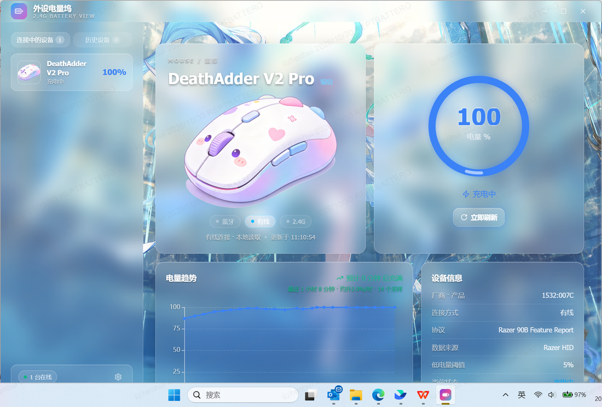
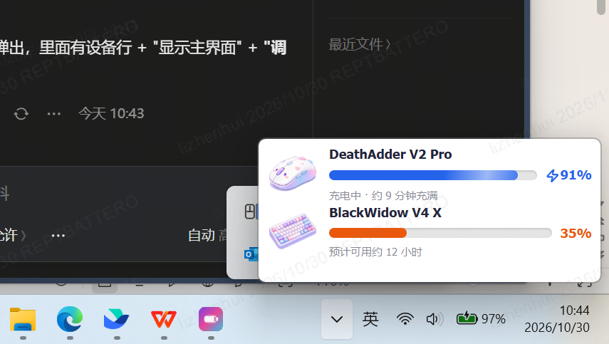

# BatteryView · 外设电量坞

> 2.4G 无线外设电量管理桌面应用 · Tauri 2.0 + Rust + React + Vite

直接在系统托盘实时显示鼠标 / 键盘 / 耳机等 2.4G 无线外设的剩余电量：图标 + 电量条一眼可读，弹窗在低电 / 充电完成等时刻自动提醒，主窗口提供毛玻璃卡片式电量仪表盘与趋势预测。





## Features

- **托盘实时电量**：每台设备一个托盘图标（Lucide 开源线条剪影 + 右侧电量竖条），电量颜色随阈值变化（充电蓝 / ≥50 绿 / ≥20 橙 / <20 红），自动适配深浅色任务栏与 DPI 缩放
- **毛玻璃主窗口**：1180×880 无边框窗口，渐变极光背景 + 毛玻璃卡片，圆环仪表盘展示当前电量
- **电量趋势预测**：本地持久化每台设备最近 500 条历史采样，基于历史数据做初步估算与稳定预测，显示"预计还能用 X"（初步估算与刷新频率联动，采样越多越准）
- **智能弹窗提醒**：充电跳变、低电量（<20%）、电量不足（20%~50%）、充满完成等场景自动弹窗（可开关）
- **多设备管理**：同时监控多台外设，设备重命名、连接方式（有线/无线）自动识别
- **开机自启**：默认开启，注册表 HKCU Run 一键管理（可关闭）
- **数据本地保存**：所有设置与历史采样仅存于本地（WebView localStorage），不联网、不上传
- **插件化架构**：通用外设电量平台 + 协议插件——雷蛇 90B / 标准 HID / BLE GATT 均为接入平台的插件；设备知识（VID/PID/名称/类型/连接/协议）收敛到一张设备注册表，新增设备不改平台代码

## Supported Devices

设备识别采用**通用平台 + 协议插件**架构：平台（DeviceManager）只面向统一 Provider 接口，负责枚举全部 HID 接口并按设备注册表过滤；雷蛇 90B、标准 HID 电池页、BLE GATT 各自实现为一个 Provider 插件，只负责读取。

### Razer（90B Feature Report，实测可用）

| 设备 | PID | 协议 | 状态 |
| --- | --- | --- | --- |
| Razer DeathAdder V2 Pro（有线 / 2.4G） | `0x007C` / `0x007D` | Razer 90B 电池 feature | ✅ 实测可用 |
| 其他 Razer 2.4G 外设（键盘/耳机/鼠标垫） | 同族 | Razer 90B 电池 feature | ⚠️ 理论支持（需真机验证） |

### 通用外设（设备注册表 `src-tauri/src/registry.rs` 驱动）

| 设备 | VID:PID | 类型 | 连接 | 电量 |
| --- | --- | --- | --- | --- |
| 达尔优 AE7 | `260D:1257` | 鼠标 | 2.4G | ⚠️ 无标准 HID 电池页 → `--` |
| 北通 黑武士 4 Pro（XInput） | `045E:028E` | 手柄 | XInput | ⚠️ 无公开协议 → `--` |
| 北通 黑武士 4 Pro（直连/2.4G） | `2E8C:*` | 手柄 | 无线 | ⚠️ 预留分支（需真机验证） |
| 京东京造键盘 | `37D7:1002` | 键盘 | 蓝牙 | ✅ BLE GATT 电池服务（0x180F/0x2A19）→ 实测真实电量 |

> 已探测确认：达尔优 AE7（2.4G 私有协议）、北通黑武士 4 Pro（XInput 形态无电量字段）在 Windows 下无公开电量读取协议，电量显示 `--` 属预期行为；京东京造键盘蓝牙接口暴露标准 GATT Battery Service（0x180F），由 BLE Provider 走 Windows GATT API 读取真实电量（实测 94%）。后续若其他厂商提供协议，在 `registry.rs` 登记新设备 +（必要时）新增/扩展一个 Provider 插件即可。

## Architecture（为什么加新设备很容易）

```
┌──────────────────────────────────────────────────────┐
│  Frontend (React/Vite)                                │
│  AppWindow / PopupPage / tray polling                 │
│  ┌──────────────────────────────────────────────────┐ │
│  │ BatteryProvider (client/src/utils/battery/types.ts)│ │
│  │   getBatteryProvider() → desktop.ts → Tauri invoke │ │
│  └──────────────────────────────────────────────────┘ │
└──────────────────────┬───────────────────────────────┘
                       │ Tauri invoke
┌──────────────────────▼───────────────────────────────┐
│  Rust 平台核心 (src-tauri/src)                         │
│  DeviceManager (manager.rs)：统一枚举 + 去重 + 路由      │
│  DeviceRegistry (registry.rs)：设备知识单一事实源        │
│  ┌──────────────┐ ┌──────────────┐ ┌──────────────┐  │
│  │ Razer Provider│ │ HID Provider │ │ BLE Provider │  │
│  │ (hid.rs 90B) │ │ (generic.rs) │ │ (ble.rs GATT)│  │
│  └──────────────┘ └──────────────┘ └──────────────┘  │
│  tray.rs 托盘渲染 · lib.rs 命令/单实例/设置/弹窗调度      │
└──────────────────────────────────────────────────────┘
```

### 添加一台新设备（三步）

1. **登记设备**（`src-tauri/src/registry.rs`）：在设备注册表加一行 `DeviceEntry { vid, pid, kind, name, connection, protocol, provider_id }`，如 `(0x260D, Some(0x1257), "mouse", "达尔优 AE7", "2.4G", "无公开协议", "hid")`；设备即自动出现在主窗口 / 托盘 / 菜单（平台统一枚举 + 注册表过滤）。
2. **电量协议**：设备暴露标准 HID 电池页（Usage Page `0x0084`）→ 完善 HID Provider 的 0x84 读取；设备有 BLE 电池服务（0x180F）→ 复用 BLE Provider；私有协议 → 仿照 `hid.rs` 新增一个 Provider 实现 `DeviceProvider` trait（只读两个方法）。无协议时保持返回 `Ok((None, false))`，前端显示 `--`，不阻塞设备识别。
3. **托盘图标**：若新设备需要托盘专属图标，把设备线条图标 PNG（Lucide 风格，128×128）放入 `src-tauri/src/assets/lucide/`，`tray.rs` 按 `kind` 自动找到并渲染（`mouse` / `keyboard` / `gamepad` 等剪影已内置）。

前端所有 UI、趋势预测、弹窗逻辑与设备无关——它们只消费 `BatteryProvider` 返回的 `BatteryDevice[]` / `BatteryReadResult`。

## Download / Install

- 正式安装版（NSIS）：`BatteryView_1.0.0_x64-setup.exe`
- MSI 包：`BatteryView_1.0.0_x64_en-US.msi`
- 绿色免安装：`battery-view.exe`（release 构建产物）

> 安装包位于 Release 页面或 `src-tauri/target/release/bundle/`。要求 Windows 10/11（WebView2 系统自带）。

## Build（本地构建）

### 环境要求

- **Node.js ≥ 22**（含 npm）
- **Rust stable**（rustup 安装，Windows 建议默认 toolchain）
- **Windows**：VS Build Tools（C++ 桌面负载）或 MSVC；本机使用 MinGW 链路时需配置 `lld` 链接器（见下）

### 构建步骤

```bash
# 1. 安装前端依赖
npm install

# 2. 构建前端产物（vite build → flatten index.html → sanitize）
npm run build

# 3. 编译 + 打包（NSIS / MSI）
cd src-tauri
npx @tauri-apps/cli@latest build
```

产物：
- 可执行文件：`src-tauri/target/release/battery-view.exe`
- 安装包：`src-tauri/target/release/bundle/nsis/*.exe`、`bundle/msi/*.msi`

> **Windows/MinGW 链接器配置**（如使用 `x86_64-pc-windows-gnu`）：需 `llvm` 的 `lld`，并设置
> `DLLTOOL=<llvm>/dlltool.exe`、`RUSTFLAGS="-C link-arg=-fuse-ld=lld"`。
> 前端构建请勿直接 `npx vite build`（会跳过 `dist/index.html` 的 flatten 与占位符清理），统一走 `npm run build`。

## Repository layout

```
battery-view/
├── client/               # 前端（React + Vite + Tailwind v4）
│   ├── src/pages/        # AppWindow（主窗口）/ PopupPage（弹窗）
│   ├── src/utils/battery/# BatteryProvider / 趋势预测 / 历史存储
│   └── src/components/ui/ # 毛玻璃 UI 组件（Radix + Tailwind）
├── src-tauri/            # Tauri 壳（Rust）
│   ├── src/manager.rs    # DeviceManager：统一枚举/去重/路由（平台核心）
│   ├── src/registry.rs   # 设备注册表：VID/PID→名称/类型/连接/协议（单一事实源）
│   ├── src/provider.rs   # DeviceProvider trait + ProviderDevice
│   ├── src/hid.rs        # Razer 90B Provider（Feature Report 读取）
│   ├── src/generic.rs    # 标准 HID Provider（统一枚举器 + 0x84 检测）
│   ├── src/ble.rs        # BLE GATT Provider（0x180F / 0x2A19）
│   ├── src/tray.rs       # 托盘图标渲染（Lucide PNG + 电量条）
│   ├── src/lib.rs        # 命令注册 / 单实例 / 设置 / 弹窗调度
│   └── scripts/          # 前端构建脚本（build-desktop.mjs）
├── assets/lucide/        # 托盘图标素材（lucide.dev, ISC 协议）
└── docs/                 # 迁移指南与截图
```

## License

[MIT](LICENSE)

托盘图标素材来自 [Lucide](https://lucide.dev)（ISC 许可证）；前端设备插画与主题均为项目自有素材。
